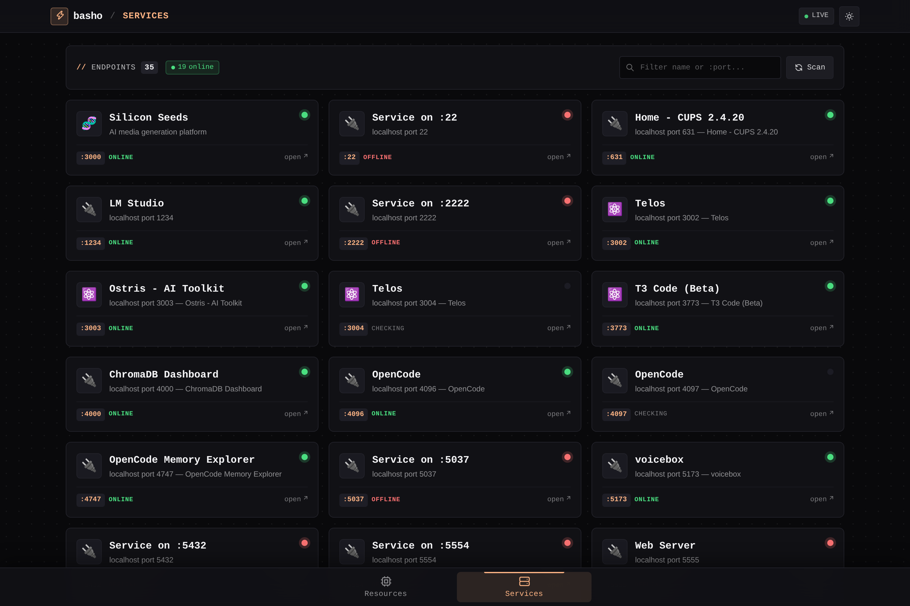
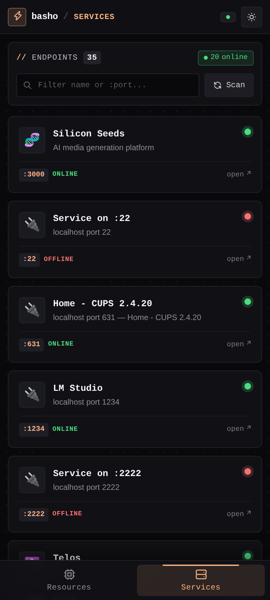

# Basho

Local-first server dashboard for monitoring system resources and discovering local web services.

## Screenshots

### Resources Dashboard


### Service Discovery



### Mobile Views

| Resources (Mobile) | Services (Mobile) |
| :---: | :---: |
|  |  |

## Features

- **Resource Telemetry** — Real-time CPU (average + per-core load matrix), RAM (usage + cache), GPU (utilization, VRAM allocation, temperature, fan speed), and Storage / Block I/O (per-physical-disk LVM-aware usage + live IOPS sparklines)
- **Quick Telemetry Strip** — At-a-glance summary cards for CPU load, memory usage, GPU utilization/temp, and block I/O ops/s with anchor jump links
- **Service Discovery** — Automatic TCP scanning of `localhost:1-9999` with HTML `<title>` extraction, live client-side online/offline health checks, instant search/port filtering, and LAN hostname rewriting for mobile access
- **Live SSE Streaming** — Server-Sent Events push unified system telemetry every 2 seconds with zero-dependency SVG sparkline charts (60-point rolling window)
- **OpenCode Theme System** — High-contrast **OpenCode Dark** (`opencode`, default) and **OpenCode Light** (`opencode-light`) themes with `localStorage` persistence
- **Mobile-First Navigation** — Sticky top status header and fixed bottom navigation bar with safe-area inset support and HTMX partial page swaps

## Stack

| Layer | Technology |
|-------|------------|
| Runtime | [Bun](https://bun.sh) |
| Framework | [Hono](https://hono.dev) |
| Frontend | [HTMX](https://htmx.org) + Server-Sent Events |
| Styling | [Tailwind CSS v4](https://tailwindcss.com) + [DaisyUI 5](https://daisyui.com) |
| Templates | Hono JSX |
| Monitoring | [systeminformation](https://systeminformation.io) + `nvidia-smi` fallback |
| Bundler | Bun (native) |

## Setup

### Prerequisites

- [Bun](https://bun.sh) >= 1.2

### Installation

```bash
git clone https://github.com/DennisLoska/basho.git basho
cd basho
bun install
```

### Configuration

Edit `config/services.json` to define static service entries:

```json
[
  {
    "name": "My App",
    "url": "http://localhost:3000",
    "description": "Description of my app",
    "icon": "🚀"
  }
]
```

Service scanning is automatic — any service listening on `localhost:1-9999` is auto-discovered (with a 30s scan cache TTL and automatic `<title>` detection) and merged with the static list. When opening Basho from another device on your LAN, `localhost` service links automatically rewrite to the current host IP.

### Building CSS

The project uses Tailwind CSS v4 with DaisyUI 5. Build the stylesheet before running:

```bash
bun run build:css
```

This compiles `src/templates/app.css` → `static/style.css`.

### Running

```bash
# Development (hot reload)
bun run dev

# Production
bun run start
```

The server starts at **http://0.0.0.0:6969**.

### Available Scripts

| Script | Command | Description |
|--------|---------|-------------|
| `dev` | `bun run dev` | Hot-reload development server |
| `start` | `bun run start` | Production server |
| `build:css` | `bun run build:css` | Compile Tailwind + DaisyUI into `static/style.css` |

## Environment

- **Port:** `6969` (hardcoded)
- **Host:** `0.0.0.0` (all interfaces)
- **Telemetry interval:** `2s` unified SSE push (`15s` keep-alive heartbeat)
- **GPU monitoring:** `systeminformation` with `nvidia-smi` CLI fallback
- **Disk monitoring:** Per-physical-disk aggregation with LVM (`/dev/mapper`, `/dev/dm-*`) awareness and real-time read/write IOPS
- **Service scan:** Concurrent TCP probes (`200` concurrency, `150ms` timeout) across ports `1-9999` on `localhost`

## Architecture

```
src/
  main.ts             — Entry point, Hono app bootstrap & static file server
  monitors/
    system.ts         — CPU, RAM, GPU, physical disk, and block I/O stats collection
  routes/
    pages.tsx         — Full-page and HTMX partial route handlers (/ and /services)
    sse.ts            — SSE endpoint (/sse/system-stats) for live telemetry
  services/
    registry.ts       — Static service config loader (config/services.json)
    scanner.ts        — Local TCP port scanner with HTTP title detection & 30s TTL cache
  templates/
    app.css           — Tailwind CSS v4 source, DaisyUI plugin & OpenCode dark/light themes
    app.tsx           — App shell (sticky top status bar + fixed mobile bottom navbar)
    dashboard.tsx     — Resource monitor dashboard (quick telemetry strip, CPU/RAM/GPU/Disk cards)
    layout.tsx        — HTML document wrapper, theme initialization & script includes
    services.tsx      — Service discovery view (search filter, online counter, endpoint cards)
config/
  services.json       — Static service definitions
static/
  favicon.svg         — Bar-chart monitoring SVG favicon
  style.css           — Built CSS (generated)
  handlers.js         — HTMX SSE handlers, SVG chart rendering, dynamic disk cards, service health checks & theme toggle
  htmx.min.js         — HTMX runtime
  htmx-ext-sse.min.js — HTMX SSE extension
docs/
  screenshots/        — Desktop and mobile UI screenshots
```
