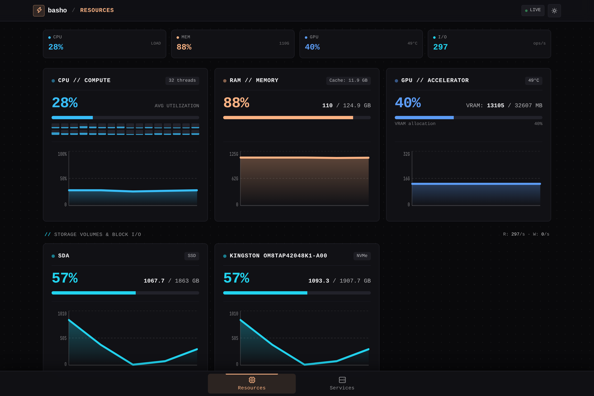
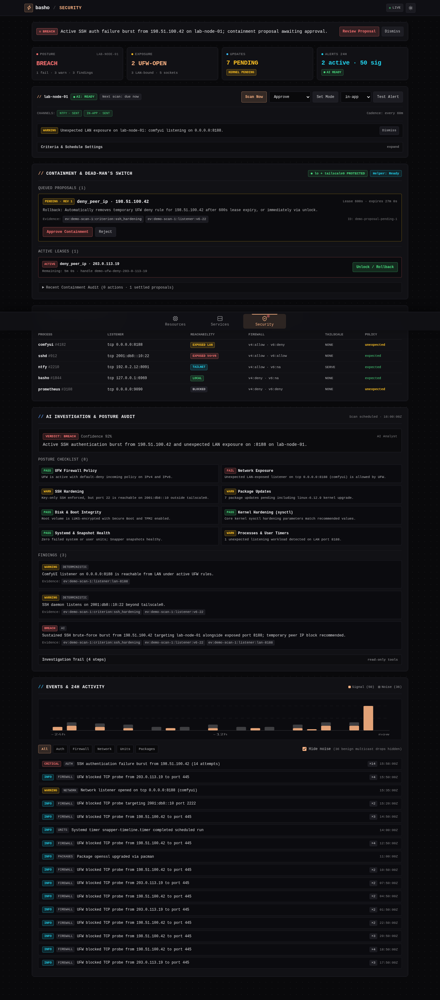
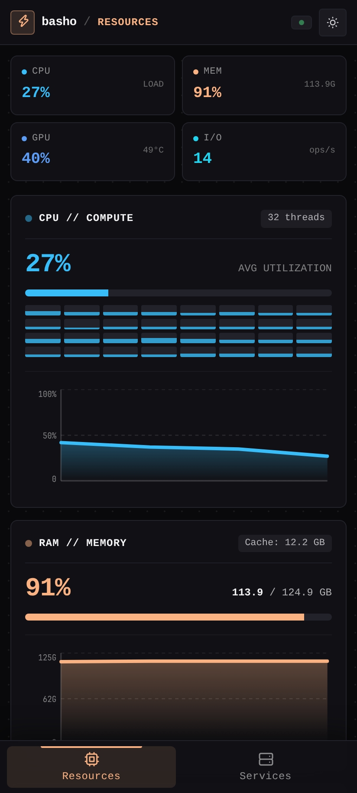
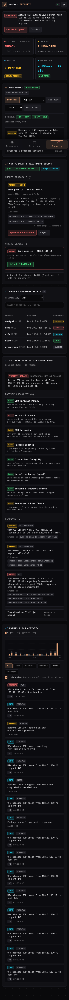

# Basho

Local-first server dashboard for monitoring system resources, discovering local web services, and running continuous host security monitoring with AI investigation and guardrailed containment.

## Screenshots

### Resources Dashboard



### Service Discovery


### Security



### Mobile Views

| Resources (Mobile) | Services (Mobile) | Security (Mobile) |
| :---: | :---: | :---: |
|  |  |  |

## Features

- **Resource Telemetry** — Real-time CPU (average + per-core load matrix), RAM (usage + cache), GPU (utilization, VRAM allocation, temperature, fan speed), and Storage / Block I/O (per-physical-disk LVM-aware usage + live IOPS sparklines)
- **Quick Telemetry Strip** — At-a-glance summary cards for CPU load, memory usage, GPU utilization/temp, and block I/O ops/s with anchor jump links
- **Service Discovery** — Automatic TCP scanning of `localhost:1-9999` (excluding port 22) with HTML `<title>` extraction, live client-side online/offline health checks, instant search/port filtering, and LAN hostname rewriting for mobile access
- **Security Posture & Network Exposure** — Continuous host hardening checks across 8 criteria, socket-to-firewall reachability matrix, journald/socket event triage, and SQLite audit history
- **AI Investigation & Triage** — Bounded read-only evidence investigation via the official OpenAI SDK (OpenCode Go or compatible endpoints) with graceful degradation when AI is unconfigured or offline
- **Tailscale-First Alerts & Guardrailed Containment** — Multi-channel alerting (`in-app`, `desktop`, `ntfy`, `discord`, `telegram`) and time-bounded containment (`monitor`, `approve`, `auto-lockdown`) protected by a `DeadMansSwitch` and independent rollback timers
- **Live SSE Streaming** — Server-Sent Events push unified system telemetry every 2 seconds (plus live security status updates) with zero-dependency SVG sparkline charts (60-point rolling window)
- **OpenCode Theme System** — High-contrast **OpenCode Dark** (`opencode`, default) and **OpenCode Light** (`opencode-light`) themes with `localStorage` persistence
- **Mobile-First Navigation** — Sticky top status header and fixed bottom navigation bar with safe-area inset support and HTMX partial page swaps

## Stack

| Layer | Technology |
|-------|------------|
| Runtime | [Bun](https://bun.sh) |
| Framework | [Hono](https://hono.dev) |
| Frontend | [HTMX](https://htmx.org) + Server-Sent Events |
| Styling | [Tailwind CSS v4](https://tailwindcss.com) + [DaisyUI 5](https://daisyui.com) |
| Templates | Hono JSX |
| Monitoring | [systeminformation](https://systeminformation.io) + `nvidia-smi` fallback |
| Persistence | SQLite via `bun:sqlite` |
| AI Investigation | [OpenAI SDK](https://github.com/openai/openai-node) (OpenCode Go / compatible endpoint) |
| Alerting | In-app, `notify-send`, Tailscale-first `ntfy`, Discord, Telegram |
| Containment | User-space systemd workloads + optional root-owned `ufw`/`systemd-run` helper |
| Bundler | Bun (native) |

## Setup

### Prerequisites

- [Bun](https://bun.sh) >= 1.2

### Installation

```bash
git clone https://github.com/DennisLoska/basho.git basho
cd basho
bun install
```

### Configuration

Edit `config/services.json` to define static service entries:

```json
[
  {
    "name": "My App",
    "url": "http://localhost:3000",
    "description": "Description of my app",
    "icon": "🚀"
  }
]
```

Service scanning is automatic — any service listening on `localhost:1-9999` (excluding port 22 so SSH logs stay clean) is auto-discovered (with a 30s scan cache TTL and automatic `<title>` detection) and merged with the static list. When opening Basho from another device on your LAN, `localhost` service links automatically rewrite to the current host IP.

### Security

The Security tab collects host posture and network exposure and shows recent events
and investigation findings. Run it with `bun run start`, or preview fictional data with:

```bash
BASHO_DEMO_SECURITY=1 BASHO_HOST=127.0.0.1 BASHO_PORT=16969 bun run start
```

Set `OPENCODE_API_KEY` in the server environment to enable AI investigation.
Basho uses the official OpenAI SDK with the configurable OpenCode Go endpoint
`https://opencode.ai/zen/go/v1`. Set `OPENCODE_BASE_URL` for a compatible endpoint.
Posture and event monitoring continue when AI is unavailable.

Configure `notifications.ntfyUrl` with the topic URL reachable from Basho over
Tailscale, and `notifications.publicOrigin` with the dashboard origin reachable
from your phone. Add `ntfy` to `notifications.channels` and use `BASHO_NTFY_TOKEN`
for a private topic. Use Test Alert to verify delivery.

#### Environment Variables

| Variable | Default | Purpose |
|----------|---------|---------|
| `OPENCODE_API_KEY` | *(unset)* | API key for AI investigation via the OpenAI SDK; AI stays `unconfigured` when omitted |
| `OPENCODE_BASE_URL` | `https://opencode.ai/zen/go/v1` | OpenAI-compatible base URL (overrides `ai.baseURL` in `config/security.json`) |
| `BASHO_HOST` | `0.0.0.0` | Bind address for the HTTP server |
| `BASHO_PORT` | `6969` | Listen port for the HTTP server |
| `BASHO_AUTH_TOKEN` | *(unset)* | Operator bearer/login token required for remote reads and mutations on `/security` |
| `BASHO_SECURITY_DB` | `data/basho-security.db` | SQLite database path for scans, events, alerts, proposals, and containment audit logs |
| `BASHO_DEMO_SECURITY` | `0` | Set `BASHO_DEMO_SECURITY=1` to run in isolated demo mode using fictional `lab-node-01` fixtures |
| `BASHO_NTFY_TOKEN` | *(unset)* | Bearer token sent in the `Authorization` header for private `ntfy` topics |
| `BASHO_DISCORD_WEBHOOK` | *(unset)* | Discord webhook URL (`discord.com` / `discordapp.com`) for `discord` alerts |
| `BASHO_TELEGRAM_BOT_TOKEN` | *(unset)* | Telegram Bot API token for `telegram` alerts |
| `BASHO_TELEGRAM_CHAT_ID` | *(unset)* | Target Telegram chat ID for `telegram` alerts |

#### Session Login & Remote Mutations

- **Same-origin session login:** When `BASHO_AUTH_TOKEN` is set, remote operators authenticate via `POST /security/login`, which issues a signed `HttpOnly; SameSite=Lax` cookie (`Secure` over HTTPS). All state-changing forms require a matching CSRF token and same-origin `Origin`/`Referer` check.
- **Remote vs. loopback writes:** Remote mutations require `BASHO_AUTH_TOKEN` and an authenticated session. When `BASHO_AUTH_TOKEN` is unset, mutations are restricted strictly to direct loopback connections (`127.0.0.1` / `::1`) without proxy forwarding headers (`X-Forwarded-For`, `Forwarded`, `X-Real-IP`, `X-Forwarded-Host`, `X-Forwarded-Proto`).

#### AI Provider & Notification Channels

- **AI provider:** Uses the official `openai` SDK against OpenCode Go (`https://opencode.ai/zen/go/v1`, default model `deepseek-v4.1-flash`) or any OpenAI-compatible endpoint configured via `OPENCODE_BASE_URL` or `config/security.json`. Investigation tools are strictly read-only and evidence-bound.
- **Alert channels (`notifications.channels`):**
  - `in-app` (default): Live dashboard alert banner, dismiss controls, and navigation indicator dot.
  - `desktop`: Local desktop notifications via `notify-send` using a fixed argument runner.
  - `ntfy`: Tailscale-first push alerts to `notifications.ntfyUrl`, sending `BASHO_NTFY_TOKEN` via the `Authorization` header and attaching a token-free `Click` deep link built from `notifications.publicOrigin`.
  - `discord`: Severity-colored embeds posted to `BASHO_DISCORD_WEBHOOK`.
  - `telegram`: Formatted alert messages sent via `BASHO_TELEGRAM_BOT_TOKEN` and `BASHO_TELEGRAM_CHAT_ID`.
- Use **Test Alert** in the Security control bar to verify end-to-end delivery for any channel.

#### Monitored Posture, Cadence & Persistence

- **Posture criteria (8 checks, configurable in `config/security.json` or the UI):** `firewall_ufw` (UFW Firewall Policy), `network_exposure` (Network Exposure), `ssh_hardening` (SSH Hardening), `package_updates` (Package Updates), `disk_and_boot` (Disk & Boot Integrity), `kernel_sysctl` (Kernel Hardening), `systemd_health` (Systemd & Snapshot Health), and `process_and_timers` (Processes & User Timers).
- **Cadence & cooldowns:** Scheduled `SecurityScan` runs every **60 minutes** by default (`scanIntervalMinutes: 60`), event-triggered AI triage uses a **10-minute** cooldown (`ai.triageCooldownMinutes: 10`), and alert deduplication uses a **15-minute** notification cooldown (`notifications.cooldownMinutes: 15`).
- **SQLite retention & permissions:** `SecurityStore` creates the database parent directory with mode `0700` and the SQLite file with mode `0600`. Retention is bounded to **50 scans**, **14 days** of security events, and **90 days** of containment actions and audit history.
- **Service discovery exclusion:** Local service discovery (`src/services/scanner.ts`) explicitly excludes port 22 so periodic port probes never generate SSH auth log noise or false security events.

#### Lockdown Modes & Recovery

Configure `mode` in `config/security.json` (or switch live in the UI):

- **`monitor`:** Collects posture, exposure, findings, and alerts only. Never queues or applies containment.
- **`approve` (default):** Queues time-bounded containment proposals (`lockdown.proposalMinutes: 30`) with revision checks. An operator must explicitly click **Approve Containment** before a temporary lease (`lockdown.leaseSeconds: 600`, valid range 30–1800s) is applied.
- **`auto-lockdown`:** Applies temporary containment automatically only when all guardrails are satisfied:
  1. AI `breach` verdict with confidence `>= 0.85` (`ai.confidenceThreshold: 0.85`),
  2. Fresh independent deterministic corroboration (`ssh_burst`, `unexpected_listener`, `system_anomaly`, or `unexpected_workload`),
  3. `DeadMansSwitch` safety checks pass (protecting loopback, Tailscale, critical system units/processes, and Basho itself), and
  4. Verified rollback readiness (`status` preflight succeeds and the rollback timer can be armed before any firewall change).
- **Recovery:** Every lease automatically reverts when its independent rollback timer expires, or immediately via the **Unlock / Rollback** button in the Security tab.

#### Optional Privileged Lockdown Helper

Firewall containment (`deny_peer_ip` and `isolate_lan_ingress`) is disabled by default (`lockdown.helperEnabled: false`). To enable it, install `scripts/basho-lockdown-helper.sh` as a root-owned executable that Basho cannot modify:

```bash
sudo install -o root -g root -m 0755 scripts/basho-lockdown-helper.sh /usr/local/libexec/basho-lockdown-helper
```

Create a narrow `/etc/sudoers.d/basho-lockdown` entry (validated with `visudo -cf`) restricted to that exact binary and its 5 supported subcommands (`status`, `deny-ip`, `isolate-lan`, `inspect`, `rollback`):

```sudoers
basho ALL=(root) NOPASSWD: /usr/local/libexec/basho-lockdown-helper status, \
  /usr/local/libexec/basho-lockdown-helper deny-ip *, \
  /usr/local/libexec/basho-lockdown-helper isolate-lan *, \
  /usr/local/libexec/basho-lockdown-helper inspect *, \
  /usr/local/libexec/basho-lockdown-helper rollback *
```

- **LAN isolation enrollment:** Create root-owned `/etc/basho-lockdown/lan-policy.conf` (mode `0644` or `0600`, owned by `root:root`) defining `LAN_INTERFACE=<iface>` (never `lo` or `tailscale*`) and `LAN_PORTS=<comma-separated-ports>` (port `41641` is rejected). Runtime lease metadata is stored in root-owned `/var/lib/basho-lockdown` (mode `0700`).
- **Readiness check & independent rollback:** Verify installation with `sudo -n /usr/local/libexec/basho-lockdown-helper status` (expects `status=ready` and `lan_policy=ready` when LAN isolation is enrolled). Before prepending any `ufw` rule, the helper arms an independent `systemd-run` rollback timer (`basho-rollback-<id>`) so leases revert automatically even if Basho crashes.
- **Preserved management paths:** Both `DeadMansSwitch` and the helper unconditionally protect loopback (`lo`, `127.0.0.0/8`, `::1`), Tailscale Tailnet management (`tailscale0`, `100.64.0.0/10`, `fd7a:115c:a1e0::/48`), and Tailscale WireGuard (`UDP/41641`).
- **Disabling helper access:** Set `"helperEnabled": false` under `lockdown` in `config/security.json` and remove `/etc/sudoers.d/basho-lockdown` and `/usr/local/libexec/basho-lockdown-helper`.

### Building CSS

The project uses Tailwind CSS v4 with DaisyUI 5. Build the stylesheet before running:

```bash
bun run build:css
```

This compiles `src/templates/app.css` → `static/style.css`.

### Running

```bash
# Development (hot reload)
bun run dev

# Production
bun run start
```

The server starts at **http://0.0.0.0:6969** by default (override with `BASHO_HOST` and `BASHO_PORT`).

### Available Scripts

| Script | Command | Description |
|--------|---------|-------------|
| `dev` | `bun run dev` | Hot-reload development server |
| `start` | `bun run start` | Production server |
| `build:css` | `bun run build:css` | Compile Tailwind + DaisyUI into `static/style.css` |
| `test` | `bun test` | Run unit, security, route, and documentation tests |

## Environment

- **Port:** `6969` default (`BASHO_PORT`)
- **Host:** `0.0.0.0` default (`BASHO_HOST`)
- **Telemetry interval:** `2s` unified SSE push (`15s` keep-alive heartbeat)
- **GPU monitoring:** `systeminformation` with `nvidia-smi` CLI fallback
- **Disk monitoring:** Per-physical-disk aggregation with LVM (`/dev/mapper`, `/dev/dm-*`) awareness and real-time read/write IOPS
- **Service scan:** Concurrent TCP probes (`200` concurrency, `150ms` timeout) across ports `1-9999` on `localhost` with port 22 excluded
- **Security store:** SQLite database at `BASHO_SECURITY_DB` (`data/basho-security.db`, `0700` dir / `0600` file)

## Architecture

The security runtime lives in `src/security/`, wired through `src/routes/security.tsx` and rendered by `src/templates/security.tsx` (with defaults in `config/security.json`, optional helper `scripts/basho-lockdown-helper.sh`, and suites under `tests/security/`).

```
src/
  main.ts                 — Entry point, Hono app bootstrap, security runtime & static file server
  monitors/
    system.ts             — CPU, RAM, GPU, physical disk, and block I/O stats collection
  routes/
    pages.tsx             — Full-page and HTMX partial route handlers (/ and /services)
    security.tsx          — Security tab routes, session login, CSRF-protected controls & proposals
    sse.ts                — SSE endpoints (/sse/system-stats, /sse/security) for live telemetry
  security/
    ai-analyst.ts         — Bounded read-only AI investigation via OpenAI SDK (OpenCode Go)
    auth.ts               — Signed HttpOnly session cookies, CSRF tokens & loopback/remote auth guards
    collector.ts          — 8-criterion posture checks and socket/UFW/Tailscale exposure collector
    config.ts             — Validated config/security.json + environment loader
    demo.ts               — Isolated lab-node-01 fixture runtime for BASHO_DEMO_SECURITY=1
    events.ts             — Bounded journald & socket burst triage and corroboration rules
    lockdown.ts           — DeadMansSwitch, mode policy, workload & privileged helper adapters
    notifications.ts      — Queued multi-channel alert dispatcher (in-app, desktop, ntfy, Discord, Telegram)
    runner.ts             — Fixed-argument subprocess runner with output and timeout bounds
    runtime.ts            — Scheduled scan loop, event triage cooldown, state orchestration & SSE bridge
    store.ts              — bun:sqlite persistence, private file permissions & bounded retention
    types.ts              — Domain types (SecurityScan, LockdownMode, SecurityAlert, AlertChannel)
  services/
    registry.ts           — Static service config loader (config/services.json)
    scanner.ts            — Local TCP port scanner (port 22 excluded) with HTTP title detection & 30s TTL cache
  templates/
    app.css               — Tailwind CSS v4 source, DaisyUI plugin & OpenCode dark/light themes
    app.tsx               — App shell (sticky top status bar + fixed mobile bottom navbar)
    dashboard.tsx         — Resource monitor dashboard (quick telemetry strip, CPU/RAM/GPU/Disk cards)
    layout.tsx            — HTML document wrapper, theme initialization & script includes
    security.tsx          — Security posture, exposure matrix, containment & event feed UI
    services.tsx          — Service discovery view (search filter, online counter, endpoint cards)
config/
  security.json           — Default security posture, AI, notification, and lockdown settings
  services.json           — Static service definitions
scripts/
  basho-lockdown-helper.sh — Optional root-owned UFW + systemd-run rollback containment helper
static/
  favicon.svg             — Bar-chart monitoring SVG favicon
  style.css               — Built CSS (generated)
  handlers.js             — HTMX SSE handlers, SVG chart rendering, dynamic disk cards, service health checks & theme toggle
  htmx.min.js             — HTMX runtime
  htmx-ext-sse.min.js     — HTMX SSE extension
tests/
  security/               — Unit, integration, helper, route/UI, and docs verification suites
docs/
  screenshots/            — Desktop and mobile UI screenshots
```
